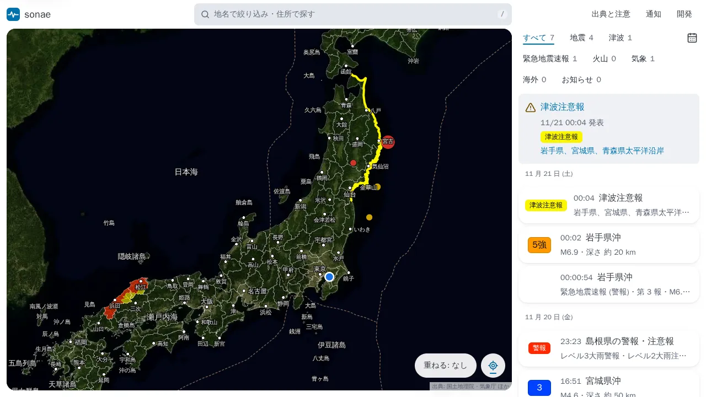
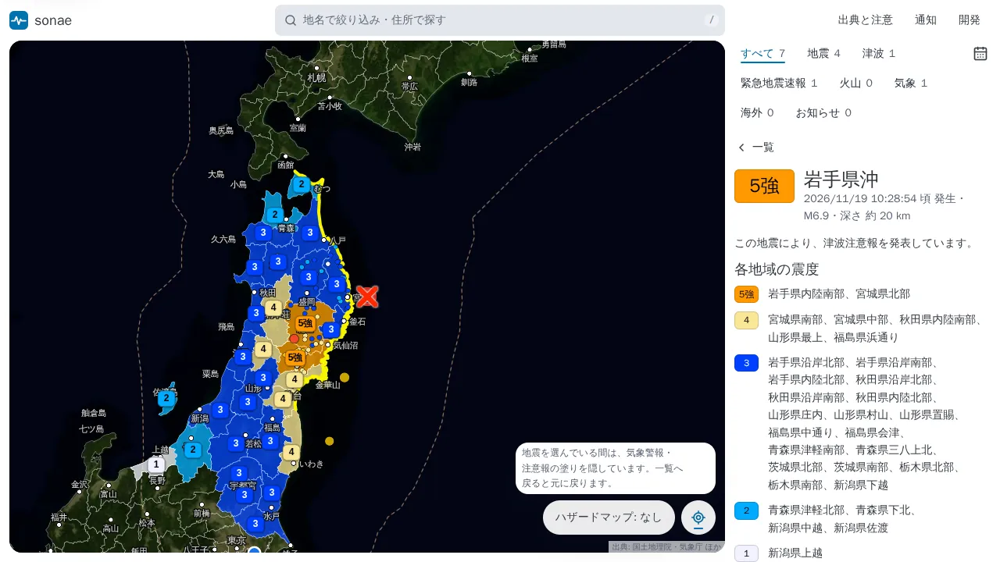
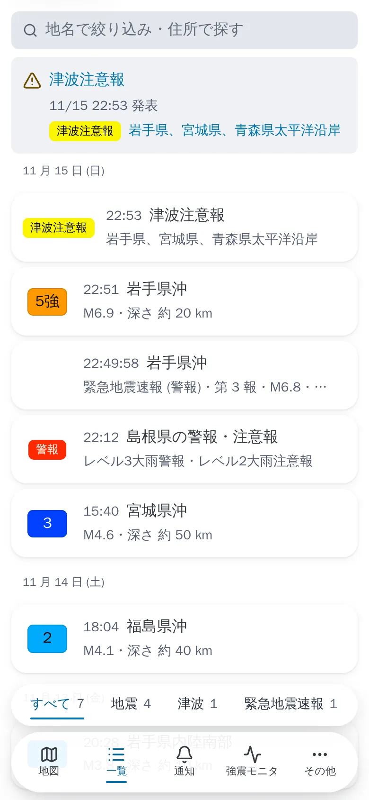

# sonae

地震・津波の情報を家のサーバーで受けて、ブラウザで見たり、Web Push で通知を受けたりするアプリ。
いまは持ち主 1 人で使う (ログインで閉じる。Entra のアプリロールで絞り、既定は `admin`。家族と共有するときは family 用のロールに替える)。ホスト名は `s.doany.io`。

<p align="center">
  
</p>

**音声つきの動画** (56 秒・1.9 MB): 試験用のデータで、緊急地震速報 → 地震の情報 → 津波注意報を受けたところ。チャイム → OS の通知 → 読み上げの流れと、地図・一覧・詳しい内容・吹き出しの動きが分かる。

<!-- 音声つきの動画: docs/images/demo.mp4 をアップロードして、ここにリンクを貼る -->

[docs/images/demo.mp4](https://raw.githubusercontent.com/danything/sonae/main/docs/images/demo.mp4) (落として開く)

<table>
  <tr>
    <td align="center"><br><sub><b>地図と一覧</b> — 各地の震度と津波注意報の海岸を地図に、全部の種類を新しい順に 1 本の一覧に</sub></td>
    <td align="center"><br><sub><b>詳しい内容</b> — 行を押すと、震源・M・各地域の震度</sub></td>
    <td align="center"><br><sub><b>通知</b> — 知らせる条件・音と読み上げ・読み上げの声・Web Push</sub></td>
  </tr>
  <tr>
    <td align="center"><br><sub><b>スマホ</b> — 地図が画面いっぱいに</sub></td>
    <td align="center"><br><sub><b>スマホの一覧</b> — 地図の上に重ねる面</sub></td>
    <td></td>
  </tr>
</table>

動画と画面は、試験用のデータ (気象庁のサンプル電文を書き換えた作り物と、手で組んだ緊急地震速報) を入れて撮った。実際の地震ではない。
読み上げの声は「VOICEVOX:剣崎雌雄」([利用規約](https://frontier.creatia.cc/fanclubs/413/posts/4507))。
動画の OS の通知は、撮ったブラウザ (ヘッドレス) に出す場所が無いので、sonae が出そうとした通知と同じ見出しと本文を、画面の右下に通知の形で描いている。

**まだ作っている途中です。** 作りは [docs/design.md](docs/design.md)、画面は [docs/ui.md](docs/ui.md)、地図の層と出典は [docs/map.md](docs/map.md) に書いてある。

- 名前は「備え」から。地震を待つのではなく、来たときに慌てないためのもの。
- [Zero Quake](https://github.com/0Quake/Zero-Quake) の機能を参考にした。コードは読んでも写してもいない (一から書いている)。
- 地震・津波・火山 (噴火速報・噴火警報) の情報を気象庁 (防災情報 XML)・P2P地震情報・Wolfx Project から、海外の地震を USGS・EMSC・GeoNet・中央氣象署 (台湾、授権碼があるとき) から、太平洋の津波の参考情報を PTWC (米国) と気象庁ホームページ (国際津波関連情報) から受け、画面には必ず出典と「公式の情報を優先してください」という注意文を出す。気象庁の情報は加工して出しているので、その旨も書く。

開いている画面では、条件に合う情報を短い音と読み上げで知らせる。読み上げの声は、sonae と一緒に動かす [VOICEVOX](https://voicevox.hiroshiba.jp/) のエンジンで作る (既定の声は「VOICEVOX:剣崎雌雄」。声は画面で選べ、この家の全部の端末で同じ声になる)。
VOICEVOX は公式のイメージを別のコンテナで動かし (理由は [docs/design.md の 2.4](docs/design.md))、`docker compose up` でも Helm chart でも sonae と一緒に起きる。
VOICEVOX が止まっているときは、ブラウザの読み上げで同じ文を読む。

## 1 行で入れる

sonae は、使う人が自分のサーバーに立てて使う (セルフホスト)。**1 行で、sonae と VOICEVOX のエンジンが立ち上がり、ブラウザが開く。** clone は要らない。

```sh
# Linux (x86_64。Docker Compose で動かす。Docker は先に入れておく)
curl -fsSL https://raw.githubusercontent.com/danything/sonae/main/install.sh | bash
# Mac (Apple Silicon・Intel。管理者のパスワードを聞かれる)
curl -fsSL https://raw.githubusercontent.com/danything/sonae/main/install.sh | sudo bash
```

```powershell
# Windows (x64。管理者の PowerShell で)
irm https://raw.githubusercontent.com/danything/sonae/main/install.ps1 | iex
```

- Linux は Docker Compose で sonae と VOICEVOX (公式のイメージ) を動かす。Mac と Windows はコンテナを使わず、配布物の bun とアプリ、公式の VOICEVOX のエンジン (CPU 版) をそのまま動かす (Mac は root の LaunchDaemon、Windows は SYSTEM のタスク)
- 開くのは <http://localhost:3030> (Linux は genkan があれば <http://sonae.localhost>)
- もう一度流せば最新に上げ直す。`--uninstall` (Windows は `-Uninstall`) で止めて外す (DB と設定は残す)。Web Push の VAPID の鍵は、無ければ作る
- **ログイン (OIDC) の設定を書くまで、画面は開かない。** 書き場所 (`sonae.env`) と、OS ごとの置き場・VOICEVOX の版と規約は [docs/install.md](docs/install.md) ([Mac](docs/install-mac.md)・[Windows](docs/install-windows.md))

## Kubernetes に立てる (Helm chart)

Kubernetes には Helm chart で入れる (セルフホストの考え方は [docs/design.md の 1 章](docs/design.md))。
chart はリリースのたびに `oci://ghcr.io/danything/charts/sonae` に出る。中身は sonae・VOICEVOX のエンジン・Service・HTTPRoute か Ingress・PVC・NetworkPolicy で、値の意味は [charts/sonae/values.yaml](charts/sonae/values.yaml) のコメントに書いてある。

1. OIDC の IdP にクライアントを作り、リダイレクト URI `https://<ホスト名>/auth/callback` を登録する (Entra ID なら [docs/entra.md](docs/entra.md))。ロール `admin` (`sonae.oidc.role` で替えられる) を持つ人だけが開ける。
2. 秘密を Secret に入れる。chart は Secret を作らない。

   ```sh
   kubectl create namespace sonae
   kubectl -n sonae create secret generic sonae-secrets \
     --from-literal=oidc-client-secret=<クライアントシークレット>
   # 任意: Web Push の VAPID の秘密鍵 (docs/push.md) と、台湾の中央氣象署の授権碼 (docs/cwa.md)
   #   --from-file=vapid-private-jwk=vapid.jwk --from-literal=cwa-api-key=<授権碼>
   ```

3. 値を書いて入れる。

   ```yaml
   # my-values.yaml
   sonae:
     oidc:
       issuer: https://login.microsoftonline.com/<テナントの ID>/v2.0
       clientId: <クライアントの ID>
   secrets:
     name: sonae-secrets
   httpRoute:
     enabled: true
     parentRefs:
       - name: <Gateway の名前>
         namespace: <Gateway の名前空間>
     hostnames:
       - sonae.example.com
   ```

   ```sh
   helm install sonae oci://ghcr.io/danything/charts/sonae -n sonae -f my-values.yaml
   ```

- 公開の URL (`PUBLIC_URL`・`ORIGIN`) は、書かなければ `httpRoute.hostnames` か `ingress.hosts` の先頭に `https://` を付けたもの。違うときは `sonae.publicUrl` に書く。
- OIDC の 3 つ (issuer・client id・Secret の `oidc-client-secret`) が揃わないと、画面は開かず `/health` だけ答える。
- VAPID の鍵が無ければ Web Push を切って動く。授権碼が無ければ中央氣象署の受信だけを切って動く。
- 既定の `image.tag` は `latest` (main に入るたびに動く)。固定するなら `ghcr.io/danything/sonae` のコミットの sha のタグを書く。
- Ingress を使うなら `ingress.enabled: true` と `ingress.hosts`。SSE (`/api/stream`) が切れないよう、前段の読み込みのタイムアウトを長くする。
- PVC は既定で Argo CD に消させない注釈が付く (`persistence.protectFromPruning`)。
- 外向きを絞る NetworkPolicy (`networkPolicy.egress.enabled`) は既定で出さない。DNS の Pod のラベルがクラスタで違うため。

このリポジトリ自身の本番 (家の Talos のクラスタ) も同じ chart で出している。値は [deploy/application.yaml](deploy/application.yaml) の `helm.valuesObject`。

## 開発

依存はホストに入れず、コンテナの中で動かす。

```sh
docker compose up            # https://sonae.localhost (genkan 経由)。VOICEVOX のエンジンも一緒に起きる
docker compose run --rm sonae bun run lint    # oxlint・整形の確かめ (bun fmt --check)
docker compose run --rm sonae bun run check   # 型 (svelte-check --tsgo)
docker compose run --rm sonae bun test tests
docker compose run --rm sonae bun run build
```

docker の代わりに `wslc-compose` でもよい。

手元ではログインを飛ばす (`AUTH_DISABLED=1`、compose.yml)。本番のログインの設定は [docs/entra.md](docs/entra.md)。
Web Push は VAPID の鍵が無ければ切って動く。鍵の作り方と入れ方は [docs/push.md](docs/push.md)。

起動すると気象庁・P2P地震情報・Wolfx・USGS・PTWC・EMSC・気象庁ホームページ (国際津波)・GeoNet (と、授権碼があれば中央氣象署) に実際につなぐ。台湾の中央氣象署の授権碼の取り方は [docs/cwa.md](docs/cwa.md)。画面だけ触りたいときは `SONAE_RECEIVE=off` で止める。

## ライセンス

[AGPL-3.0](LICENSE)
