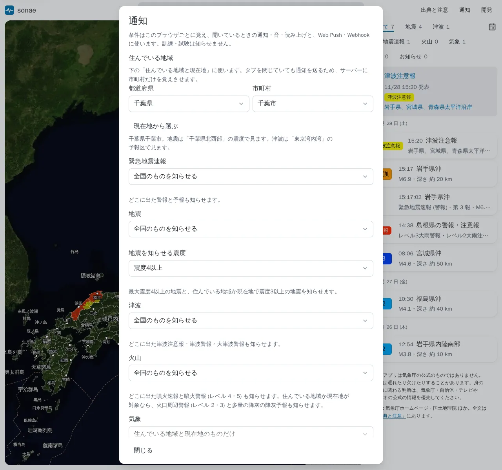
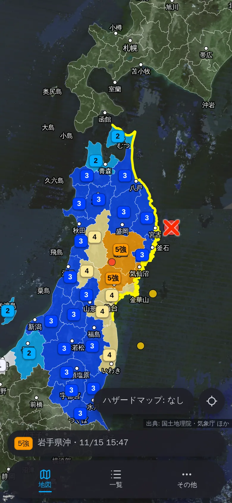

# sonae

地震・津波・火山・気象の情報を家のサーバーで受けて、ブラウザで見たり、Web Push や Discord・Slack の Webhook で通知を受けたりするアプリ。
自分と家族のために、自分のサーバーに 1 つ立てて使う (セルフホスト)。家の LAN からはログインなしで、外からは OIDC のログインで開く。

<p align="center">
  
</p>

**音声つきの動画** (58 秒・1.9 MB): 試験用のデータで、緊急地震速報 → 地震の情報 → 津波注意報を受けたところ。チャイム → OS の通知 → 読み上げの流れと、読み上げ始めた報の詳しい内容が自動で開くようす、読み上げ中断のボタン、地図・一覧・吹き出しの動きが分かる。

https://github.com/user-attachments/assets/10623080-5ec4-4150-8a29-319a88e5f30b

[docs/images/demo.mp4](https://raw.githubusercontent.com/danything/sonae/main/docs/images/demo.mp4) (落として開く)

<table>
  <tr>
    <td align="center"><br><sub><b>地図と一覧</b> — 津波注意報の海岸と気象の警報・注意報を地図に、全部の種類を新しい順に 1 本の一覧に</sub></td>
    <td align="center"><br><sub><b>詳しい内容</b> — 行を押すと、震源・M・各地域の震度。地図も各地の震度で塗り、観測点ごとの震度を丸で置く</sub></td>
    <td align="center"><br><sub><b>通知</b> — 種類ごとに全国・住んでいる地域と現在地・知らせないを選ぶ。音と読み上げ・Web Push・Webhook も</sub></td>
  </tr>
  <tr>
    <td align="center"><br><sub><b>スマホ</b> — 地図が画面いっぱいに。下に選んだものの 1 行と 5 つのタブ</sub></td>
    <td align="center"><br><sub><b>スマホの一覧</b> — 地図を上に残し、その下で一覧を巻く。種類のチップは下に</sub></td>
    <td></td>
  </tr>
</table>

動画と画面は、試験用のデータ (気象庁のサンプル電文を書き換えた作り物と、手で組んだ緊急地震速報) を入れて撮った。実際の地震ではない。
読み上げの声は「VOICEVOX:剣崎雌雄」([利用規約](https://frontier.creatia.cc/fanclubs/413/posts/4507))。
動画の OS の通知は、撮ったブラウザ (ヘッドレス) に出す場所が無いので、sonae が出そうとした通知と同じ見出しと本文を、画面の右下に通知の形で描いている。

作りは [docs/design.md](docs/design.md)、画面は [docs/ui.md](docs/ui.md)、地図の層と出典は [docs/map.md](docs/map.md) に書いてある。

- 名前は「備え」から。地震を待つのではなく、来たときに慌てないためのもの。
- [Zero Quake](https://github.com/0Quake/Zero-Quake) の機能を参考にした。コードは読んでも写してもいない (一から書いている)。
- 地震・津波・火山 (噴火速報・噴火警報)・気象 (警報・注意報など) の情報を気象庁 (防災情報 XML) から、地震・津波を P2P地震情報・Wolfx Project からも、海外の地震を USGS・EMSC・GeoNet・中央氣象署 (台湾、授権碼があるとき) から、太平洋の津波の参考情報を PTWC (米国) と気象庁ホームページ (国際津波関連情報) から受け、画面には必ず出典と「公式の情報を優先してください」という注意文を出す。気象庁の情報は加工して出しているので、その旨も書く。
- 地図には、台湾の観測点のいまの揺れ (ExpTech の [TREM](https://exptech.dev) の RTS。非公式) と、有志の観測点のいまの揺れ (Wolfx Project の [SeisJS](https://wolfx.jp/docs/seisjs-api/)。非公式) を点の色で出す。地図に出すだけで、一覧・音・読み上げ・通知では知らせない。
- 地図の右下の選択で、気象庁の「いま」の雨雲 (高解像度降水ナウキャスト)・キキクル (土砂・大雨の危険度) か、ハザードマップ (洪水・土砂災害・津波・活断層) を 1 つ重ねられる。海上保安庁の海しるの海底地殻変動観測点と海域火山 (API のキーがあるとき) と、国土交通省の「通れるマップ」の災害時の通行止めと通れた道 (管理者が災害の URL を登録したとき) も地図に出す。

知らせる条件は、緊急地震速報・地震・津波・火山・気象のそれぞれで「全国のものを知らせる」「住んでいる地域と現在地のものだけ」「知らせない」から選ぶ。地震は、知らせる震度も選ぶ。
ほかの段 (注意報も知らせるかなど) は決めてあり、選んだもので何を知らせるかを画面に 1 文で出す ([docs/design.md の 2.4](docs/design.md#24-web-push) の表)。
特別警報にあたるもの (気象の特別警報・大津波警報・噴火警報 (レベル 4・5)) と、南海トラフ地震臨時情報・後発地震注意情報は、「知らせない」を選んでもいつも知らせる。

開いている画面では、条件に合う情報を短い音と読み上げで知らせる (「オフ」「通知音だけ」「読み上げも」から選ぶ)。読み上げの声は、sonae と一緒に動かす [VOICEVOX](https://voicevox.hiroshiba.jp/) のエンジンで作る (既定の声は「VOICEVOX:剣崎雌雄」。声は画面で選べ、この家の全部の端末で同じ声になる)。
エンジンは sonae とは別のプロセスで動かし (理由は [docs/design.md の 2.4 の「読み上げ」](docs/design.md#読み上げ-voicevox))、1 行のインストーラでも `docker compose up` でも Helm chart でも sonae と一緒に起きる。
エンジンが止まっているときは、ブラウザの読み上げで同じ文を読む。

タブを閉じていても、条件に合う情報を Web Push でブラウザに届ける。Discord や Slack の Incoming Webhook の URL を「通知」に足せば、同じ情報を同じ見出しと本文でチャンネルにも送る (Home Assistant のような、JSON を受ける送り先にも送れる。[docs/push.md の「Webhook」](docs/push.md#webhook))。

## 1 行で入れる

**1 行で、sonae と VOICEVOX のエンジンが立ち上がり、ブラウザが開く。** clone は要らない。

```sh
# Linux (x86_64。Docker Compose で動かす。Docker は先に入れておく)
curl -fsSL https://raw.githubusercontent.com/danything/sonae/main/install.sh | bash
# Mac (Apple Silicon・Intel。管理者のパスワードを聞かれる)
curl -fsSL https://raw.githubusercontent.com/danything/sonae/main/install.sh | sudo bash
```

```powershell
# Windows (x64。管理者の PowerShell で)
irm https://raw.githubusercontent.com/danything/sonae/main/install.ps1 | iex
```

- Linux は Docker Compose で動かす。Mac と Windows はコンテナを使わず、配布物の bun とアプリ、公式の VOICEVOX のエンジン (CPU 版) をそのまま動かす (Mac は root の LaunchDaemon、Windows は SYSTEM のタスク)
- 開くのは、Mac・Windows は <http://localhost:3030>、Linux は genkan があれば <http://sonae.localhost>、無ければ `http://<IP>:3030`。もう一度流せば最新に上げ直し、`--uninstall` (Windows は `-Uninstall`) で止めて外す (DB と設定は残す)
- **家の LAN (とそのマシンのブラウザ) からは、ログインなしで開ける** (`sonae.env` の `TRUSTED_NETWORKS`)。その中の誰でも設定を変えられるので、家の外からも開くならログイン (OIDC) を足す。http の LAN の IP で開いた端末では Web Push は使えない
- 置き場・環境変数・ログイン・VOICEVOX のバージョンと規約は [docs/install.md](docs/install.md) ([Mac](docs/install-mac.md)・[Windows](docs/install-windows.md))

## Kubernetes に立てる (Helm chart)

Kubernetes には Helm chart で入れる (セルフホストの考え方は [docs/design.md の 1 章](docs/design.md#1-目的と範囲))。
chart はリリースのたびに `oci://ghcr.io/danything/charts/sonae` に出る。中身は sonae・VOICEVOX のエンジン・Service・HTTPRoute か Ingress・PVC・NetworkPolicy で、値の意味は [charts/sonae/values.yaml](charts/sonae/values.yaml) のコメントに書いてある。

1. OIDC の IdP にクライアントを作り、リダイレクト URI `https://<ホスト名>/auth/callback` を登録する (Entra ID なら [docs/entra.md](docs/entra.md))。ロール `admin` (`sonae.oidc.role` で替えられる) を持つ人だけが開ける。
2. 秘密を Secret に入れる。chart は Secret を作らない。

   ```sh
   kubectl create namespace sonae
   kubectl -n sonae create secret generic sonae-secrets \
     --from-literal=oidc-client-secret=<クライアントシークレット>
   # 任意: Web Push の VAPID の秘密鍵 (docs/push.md)・台湾の中央氣象署の授権碼 (docs/cwa.md)・海しるの API のキー (docs/design.md の 2.11)
   #   --from-file=vapid-private-jwk=vapid.jwk --from-literal=cwa-api-key=<授権碼> --from-literal=msil-api-key=<キー>
   ```

3. 値を書いて入れる。

   ```yaml
   # my-values.yaml
   sonae:
     oidc:
       issuer: https://login.microsoftonline.com/<テナントの ID>/v2.0
       clientId: <クライアントの ID>
   secrets:
     name: sonae-secrets
   httpRoute:
     enabled: true
     parentRefs:
       - name: <Gateway の名前>
         namespace: <Gateway の名前空間>
     hostnames:
       - sonae.example.com
   ```

   ```sh
   helm install sonae oci://ghcr.io/danything/charts/sonae -n sonae -f my-values.yaml
   ```

- 公開の URL (`PUBLIC_URL`・`ORIGIN`) は、書かなければ `httpRoute.hostnames` か `ingress.hosts` の先頭に `https://` を付けたもの。違うときは `sonae.publicUrl` に書く。
- OIDC の 3 つ (issuer・client id・Secret の `oidc-client-secret`) が揃わないと、画面は開かず `/health` だけ答える。ただし `secrets.name` の Secret に `oidc-client-secret` が無いと、Pod が起動しない。chart は `TRUSTED_NETWORKS` を書かない (書くなら `sonae.extraEnv`。[docs/install.md の「ログイン」](docs/install.md#ログイン))。
- VAPID の鍵が無ければ Web Push を切って動く。授権碼が無ければ中央氣象署の受信だけを、海しるのキーが無ければ海しるの点だけを切って動く。災害時の通行止めは `sonae.roadGeojson` に通れるマップの GeoJSON の URL を書いたときだけ出す (docs/design.md の 2.12)。
- 既定の `image.tag` は `latest` (main に中身の変更が入るたびに動く)。固定するなら `ghcr.io/danything/sonae` のコミットの sha のタグを書く。
- Ingress を使うなら `ingress.enabled: true` と `ingress.hosts`。SSE (`/api/stream`) が切れないよう、前段の読み込みのタイムアウトを長くする。
- PVC は既定で Argo CD に消させない注釈が付く (`persistence.protectFromPruning`)。
- 外向きを絞る NetworkPolicy (`networkPolicy.egress.enabled`) は既定で出さない。DNS の Pod のラベルがクラスタで違うため。出すとプライベートのアドレスを閉じるので、家の LAN の Webhook の送り先 (Home Assistant など) は `networkPolicy.egress.extraTo` に足す。

このリポジトリの持ち主の本番 (`s.doany.io`。家の Talos のクラスタ) も同じ chart で出している。値は [deploy/application.yaml](deploy/application.yaml) の `helm.valuesObject`。

## 開発

依存はホストに入れず、コンテナの中で動かす。

```sh
docker compose up            # https://sonae.localhost (genkan 経由)。VOICEVOX のエンジンも一緒に起きる
docker compose run --rm sonae bun run lint    # oxlint・整形の確かめ (bun fmt --check)
docker compose run --rm sonae bun run check   # 型 (svelte-check --tsgo)
docker compose run --rm sonae bun test tests
docker compose run --rm sonae bun run build
```

docker の代わりに `wslc-compose` でもよい。

手元ではログインを飛ばす (`AUTH_DISABLED=1`、compose.yml)。本番のログインの設定は [docs/entra.md](docs/entra.md)。
Web Push は VAPID の鍵が無ければ切って動く。鍵の作り方と入れ方は [docs/push.md](docs/push.md)。

起動すると気象庁・P2P地震情報・Wolfx・USGS・PTWC・EMSC・気象庁ホームページ (国際津波)・GeoNet・ExpTech TREM・Wolfx SeisJS (と、授権碼があれば中央氣象署、キーがあれば海しる、URL を登録すれば国土交通省の通れるマップ) に実際につなぐ。台湾の中央氣象署の授権碼の取り方は [docs/cwa.md](docs/cwa.md)。画面だけ触りたいときは `SONAE_RECEIVE=off` で止める。緊急地震速報の訓練・試験も一覧と地図に出すときは `SONAE_TRAINING=on` (知らせはしない)。

## ライセンス

[AGPL-3.0](LICENSE)

使っている情報源の条件は、それぞれの規約に従う ([docs/design.md の「情報源の判断」](docs/design.md#情報源の判断))。
台湾の観測点の揺れ (ExpTech の TREM-RTS) は、ExpTech の[授權頁](https://exptech.dev/docs/api/start/license/)で「註明來源・不可商用」(出典を書けば非商用で使える) のデータです。
**商用で立てる (有料のサービス・広告や課金のあるアプリ・サイトで使う) なら、ExpTech の同意が要ります。** 同意が無ければ、環境変数 `SONAE_TREM=off` で受信を切ってください。
有志の観測点の揺れ (Wolfx SeisJS) は、家庭のセルフホストで家族の地図に出すのは利用目的の範囲内と Wolfx から答えをもらっています。公開のサービスとしての使い方は聞いていません (`SONAE_SEISJS=off` で受信を切れます)。
